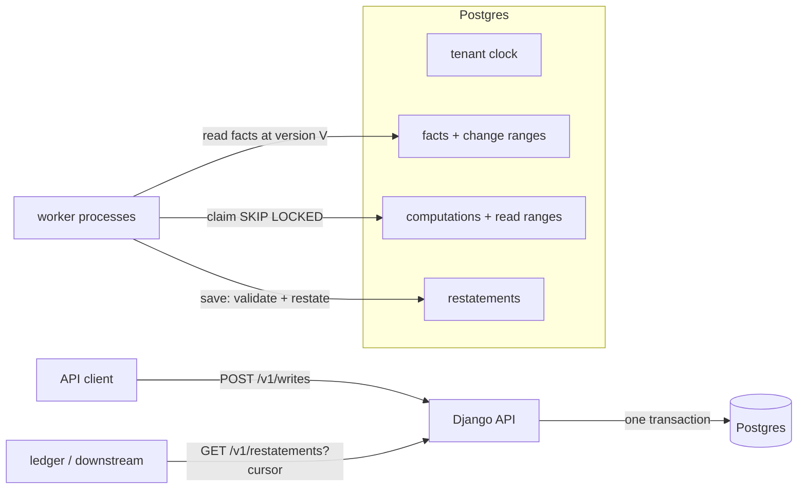

# Architecture

## Pieces



There are two kinds of process and one database. API processes take writes and serve reads. Worker processes recompute. Neither talks to the other. Everything goes through Postgres, so you can run more of either and restart them at any time.

## Data

| Table | What a row means |
|---|---|
| `tenantclock` | The tenant's latest committed knowledge version. |
| `changeset` | One write that changed something, with its version, actor and reason. |
| `fact` | `(entity, attribute)` has `value` over `valid` (a daterange), as believed from version `tx_from` until `tx_to`. |
| `changerange` | A valid-time slice of one attribute that a changeset actually changed. |
| `computation` | One derived result: `(derivation, key)`, its status, its result, and the version it was computed at. |
| `readrange` | A valid-time slice of an attribute that a computation read last time it ran. |
| `derivedread` | A computation that used another computation's result, and which result seq it saw. |
| `restatement` | Append-only. A derived result changed from `previous` to `current`, with a numeric `delta`. |
| `idempotencyrecord` | The stored response for an `Idempotency-Key`. |

The one constraint everything leans on:

```sql
EXCLUDE USING gist (tenant_id WITH =, entity WITH =, attribute WITH =, valid WITH &&)
  WHERE (tx_to IS NULL)
```

Among rows currently believed, an attribute never has two values on the same day. Superseded rows (`tx_to` set) are kept forever and may overlap anything.

## A write

```
BEGIN
  SELECT version FROM tenantclock WHERE tenant = T FOR UPDATE       -- 1
  load current rows of each touched (entity, attribute)
  apply ops in memory, diff old timeline vs new                     -- 2
  if nothing differs: record idempotency key, COMMIT, done          -- 3
  UPDATE tenantclock SET version = version + 1                      -- 4
  close rows that are no longer true (tx_to = V)
  insert the new rows (tx_from = V)
  insert one changerange per differing span
  mark fresh computations whose readranges overlap a changerange,
    and everything that depends on them, stale                      -- 5
COMMIT
```

1. Holding the clock row lock until commit means versions in a tenant commit in order. When a reader sees version N, every write up to N is visible, and nothing at or below N can still appear. That is what makes `?version=N` reads repeatable.
2. The timeline algebra (`backdate/timeline.py`) does the splitting that `FOR PORTION OF` would do. Changing March inside a row that covers all of 2024 closes that row and inserts three: Jan to Feb with the old value, March with the new one, April onwards with the old value.
3. Writing a value that is already true changes nothing, spends no version and invalidates nothing. Retries are cheap.
4. Rows whose `(span, value)` survives unchanged are left alone. History only grows by what actually changed.
5. Invalidation is one SQL statement. It joins the change ranges against the read ranges with the GiST `&&` operator, then walks `derivedread` recursively. It runs in the write's transaction, so no reader can see the new facts next to a result that still says it is fresh.

## A recompute

```
claim (own transaction, commits immediately):
  UPDATE computation SET lease_owner, lease_token += 1, lease_expires_at, attempts += 1
   WHERE id IN (SELECT ... WHERE status IN (pending, stale) AND runnable
                ORDER BY ... LIMIT n FOR UPDATE SKIP LOCKED)
  RETURNING id, token

compute (no transaction):
  V = committed clock value
  run fn(ctx, key); every ctx.timeline / ctx.value_at is pinned to V and recorded

save (one transaction):
  SELECT ... FROM tenantclock FOR SHARE            -- waits out any in-flight writer
  SELECT ... FROM computation WHERE id FOR UPDATE
  token changed?                                   -> FENCED, write nothing
  any changerange with version > V overlapping what we read?   -> REQUEUE
  any source computation whose seq moved?          -> REQUEUE
  result differs?  -> result_seq += 1, insert restatement with delta
  status = fresh, result_version = V, replace readranges and derivedreads
  result changed and others depend on it?  -> mark them stale (SKIP LOCKED)
COMMIT
```

### Why no invalidation is lost

The race to worry about: a worker reads at version 7, a writer commits version 8 that changes something the worker read, and the worker then saves its version-7 answer as fresh. The writer's invalidation can't catch it, because the result wasn't fresh when the writer ran.

The save closes this:

- A writer holds the clock `FOR UPDATE` until it commits. The save takes it `FOR SHARE`. So when the save gets the lock, every write with a version up to the current clock has committed, and its change ranges are visible.
- The save then looks for any change range above version 7 that overlaps its reads. Version 8's ranges are there, so it requeues instead of saving.
- No writer can start while the save holds the share lock. Any writer after the save commits sees the new read ranges, and a `result_version` below its own version, so it marks the result stale the usual way.

`tests/test_races.py` drives these interleavings one step at a time. `tests/test_concurrency.py` runs writers and workers together on real threads, then checks every result against a from-scratch recompute.

### Lock order

Every path that takes more than one lock takes the tenant clock first. Claims take only computation rows, with `SKIP LOCKED`, so they never wait. A save locks its own row `FOR UPDATE` and its sources `FOR SHARE`, in id order. A saver marking dependents stale uses `SKIP LOCKED`. A dependent that is locked is mid-save, and its save re-checks this source's seq, so it will requeue itself. That way no two savers wait on each other in opposite directions.

### Crashes

- **Worker killed mid-compute.** Its lease runs out. The next claim bumps the token, so if the dead worker comes back and tries to save, the save is fenced off.
- **Worker killed mid-save.** The transaction rolls back. The row keeps its lease until expiry, then is claimed again.
- **Writer killed mid-transaction.** Postgres rolls back. The clock was never bumped in committed state, so no version is skipped.
- **Postgres restarts.** Everything is in committed rows. Workers reconnect on their next claim.

`tests/test_crash.py` does each of these with `SIGKILL` or `pg_terminate_backend`.

## Reads

Every read takes a version. The default is the latest committed version, fetched once at the start of the call. A fact row is visible at version V when `tx_from <= V AND (tx_to IS NULL OR tx_to > V)`. Rows are never updated except to set `tx_to` once, from NULL to a version above any reader's V. So a read at V returns the same thing forever.

## The restatement feed

Consumers page through `GET /v1/restatements?cursor=...`. The cursor is `(txid, id)` of the last row seen, where `txid` is the id of the transaction that inserted the row.

A plain `id > cursor` feed loses rows. Ids are taken at insert time, but rows become visible at commit time, so a row with a lower id can commit after a consumer has already moved past it. The feed only returns rows whose txid is below `pg_snapshot_xmin(pg_current_snapshot())`, which is the oldest transaction still running. Every transaction below that point has finished, so no new row can appear behind the cursor. The price is that rows show up only after every transaction older than theirs has finished.

## Tenancy

Every query filters by tenant, and the tenant comes only from the API key. As a second line, migration `0002` turns on row-level security with a policy on `current_setting('backdate.tenant_id')`. The API sets that per request. Under a non-owner role, a query that forgets its tenant filter returns nothing. A connection that never set the value also sees nothing. `tests/test_rls.py` checks this as a non-superuser role.

## Backpressure

A write is refused with `503` and `Retry-After` once the tenant has more than `BACKDATE_MAX_STALE_BACKLOG` results waiting. Writes are cheap and recomputes are not. Without this limit, a bulk backdate could queue hours of work while every read returns stale results.

## Where the time goes

See [benchmarks.md](benchmarks.md) for measured numbers. In short:

- Writes in one tenant are serialized by the clock. That is the ceiling, and it is per tenant.
- Recompute scales with worker processes until Postgres or the CPU count stops it.
- Derivations are Python, so a single worker process is bound by the GIL. Scale workers as processes, not threads.
